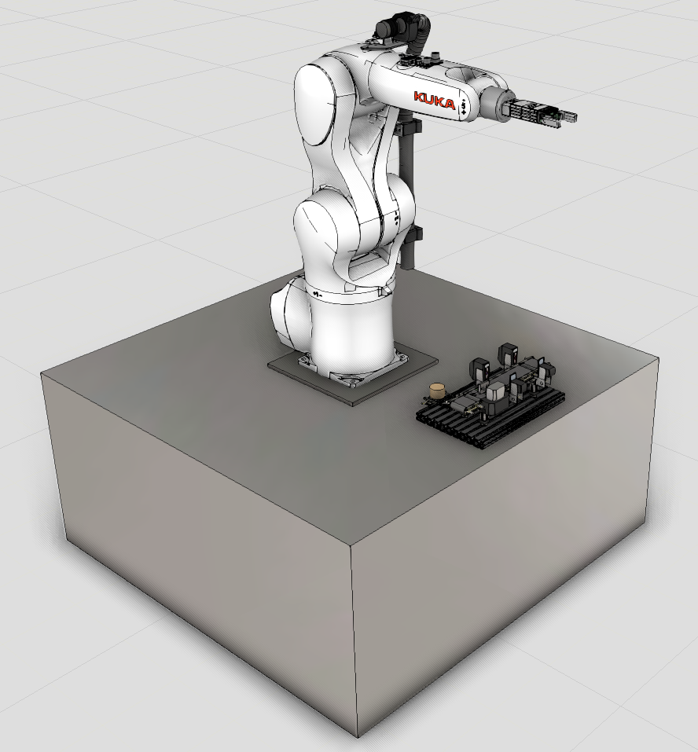
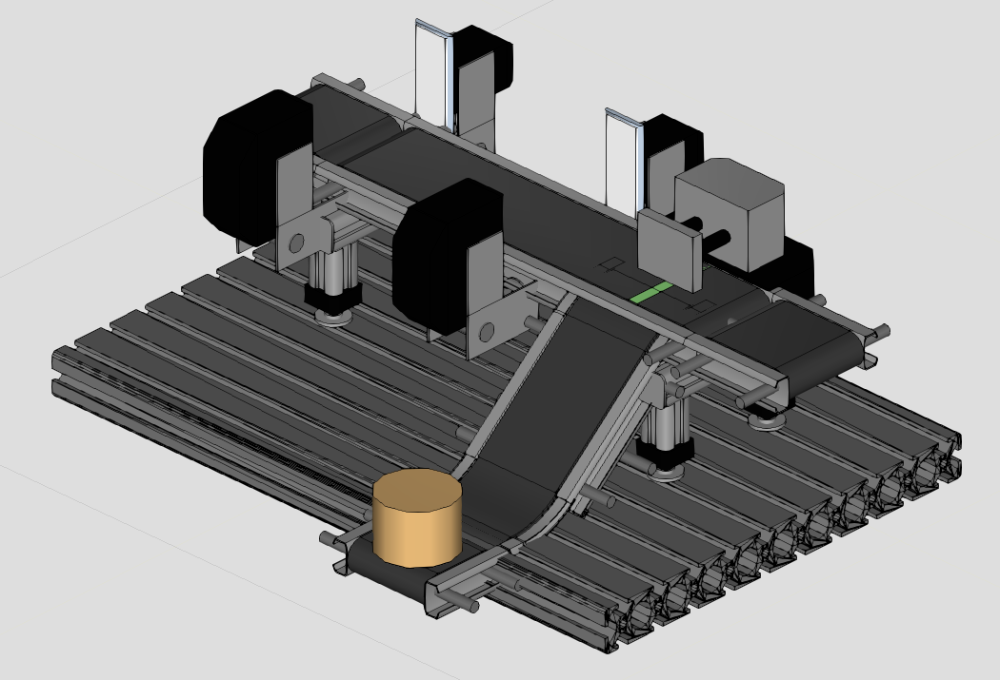

---
title: "Gathering 2: From simulation to the robot cell"
draft: false
---

# Objective

In this gathering, you will program a KUKA KR 6 R700 Agilus robot to work with
a PLC-controlled Festo MecLab conveyor station. The exercise is deliberately
small: one workpiece circulates between the conveyor and the robot. The main
challenge is not the number of motions, but coordinating two controllers and
transferring a program from simulation to a real industrial robot.

You receive the Visual Components (VC) model with the robot, gripper, conveyor,
and workpiece, but without the robot program. This page guides you through the
work in the intended order: understand the cycle, teach and test it in VC, add
the PLC handshake, and then commission the generated program in the physical
cell. @fig-gathering2-cell shows the supplied starting point.

{#fig-gathering2-cell width="82%" fig-align="center"}

# The task

The robot is equipped with a Schunk EGP 40-N-N-B gripper. The conveyor has an
inductive sensor near its start and a photoelectric sensor near the pusher. The
workpieces are plastic cylinders with a diameter of 40 mm and a height of
25 mm. Some have a metallic coating. The inductive sensor identifies these
workpieces near the start of the conveyor, and the PLC stores the sorting
decision. When the workpiece later reaches the photoelectric sensor, that
sensor provides the timing for the pusher. Metal-coated workpieces are pushed
onto the slide, while uncoated plastic workpieces continue along the conveyor.
In this gathering, the robot keeps one metal-coated workpiece circulating. The
cycle is:

1. The PLC reports that a workpiece is ready at the bottom of the slide.
2. The robot picks it up and reports that the pickup is complete.
3. The robot places it at the start of the conveyor.
4. The conveyor detects the metal coating and later pushes the workpiece onto
   the slide, after which the sequence repeats.

@fig-gathering2-conveyor shows the recreated conveyor model and the two places
that matter to the robot: the pickup point at the bottom of the slide and the
placement point at the start of the belt.

{#fig-gathering2-conveyor width="80%" fig-align="center"}

# Build the robot program in VC

Start by making the complete robot motion work in VC before transferring it to
the real controller. The [VC robot-programming sections](visual_components.qmd#sec-vc-robots)
introduce jogging, teaching, routines, and robot I/O.

## Teach the motion sequence

Use a separate routine for one complete pick-and-place cycle. A suitable
sequence is:

1. Move to an approach pose above the workpiece at the slide.
2. Move linearly to the pickup pose.
3. Close the gripper and allow time for it to reach the commanded state.
4. Retract linearly until the robot and workpiece are clear of the slide.
5. Tell the PLC that the workpiece has been picked up and removed.
6. Move to an approach pose above the conveyor start.
7. Move linearly to the placement pose and open the gripper.
8. Retract to a clear pose.

Use point-to-point motion for unobstructed transfer moves and linear motion
where the TCP must approach or leave the workpiece along a controlled path.
For every motion statement, select `BASE_DATA[1]` as the base and `TCP` as the
tool. Do not rely only on the active frames in the **Jog** panel: the base and
tool must be assigned to the motion statements for the KUKA program to export
correctly. The [frames and poses](frames_poses.qmd) page explains what these
frames represent.

Teach the pickup first and run the simulation until the gripper has grasped
the workpiece. Then jog the robot with the workpiece attached and teach the
placement pose. This shows the actual workpiece position and orientation
relative to the TCP instead of requiring you to estimate them with an empty
gripper. Snapping can help when aligning the held workpiece with the conveyor.

Use meaningful target names such as `PickApproach`, `Pick`, `PlaceApproach`,
and `Place`. Keep an eye on reachability, joint limits, robot configuration,
and collisions while teaching
([Reachability, limits, and collisions](visual_components.qmd#sec-vc-robot-analysis)).

## Structure the main routine

The main routine only coordinates repeated execution. The following is
pseudocode, not KUKA or VC syntax:

```text
SET PickedUp to false

WHILE true
    WAIT until ReadyToPick is true
    CALL PickAndPlace
END WHILE
```

Inside `PickAndPlace`, set `PickedUp` to true after the gripper has closed and
the robot has retracted clear of the pickup point. Keep it true while the robot
transfers and places the workpiece, then reset it before the routine ends. The
PLC sets `ReadyToPick` after the pusher has delivered the workpiece to the
slide. It keeps the signal true until it sees `PickedUp`, and then clears it.
The robot resets `PickedUp` before the routine ends and returns to waiting for
the next `ReadyToPick` signal.

In the VC Program Editor, implement these interactions with **Wait for Binary
Input** and **Set Binary Output** statements. The postprocessor translates
them into the corresponding input waits and output assignments for the KUKA
controller.

# Robot I/O

We use four binary robot signals: two gripper commands and two signals for the
PLC handshake. Their directions are described from the robot's perspective.
Confirm that these robot ports are connected to the intended PLC variables in
the EtherCAT mapping before running the generated KUKA program.

These numbers identify robot I/O ports in VC and the generated KUKA program;
they are not EtherCAT addresses or physical terminal numbers. In VC,
`IN[103]` is driven directly by the pusher sensor so that the robot program can
be tested without the PLC. In the physical cell, it receives the PLC's
`ReadyToPick` signal through EtherCAT.

| Robot signal | Port | Direction | Purpose |
|---|---:|---|---|
| `OpenGripper` | `OUT[101]` | Robot to PLC/equipment | Request the gripper to open. |
| `CloseGripper` | `OUT[102]` | Robot to PLC/equipment | Request the gripper to close. |
| `ReadyToPick` | `IN[103]` | PLC to robot | A metal-coated workpiece is waiting at the pickup position. |
| `PickedUp` | `OUT[103]` | Robot to PLC | The robot has removed the workpiece from the pickup position. |

Before requesting one gripper direction, reset the opposite command; do not
command opening and closing simultaneously. The supplied VC gripper also has
simulated open and closed state signals. These can help when testing in VC, but
they are not automatically available from the physical gripper unless
corresponding feedback has been wired and mapped.

## VC actions and physical I/O are different

The same robot program has two different environments around it:

| Function | In the VC model | In the physical cell |
|---|---|---|
| Move the gripper fingers | Robot outputs are connected directly to the simulated gripper's open and close inputs. | The robot output bits are transferred over EtherCAT. The PLC uses them to control the gripper's physical inputs. |
| Hold the workpiece | **Actions Configuration** uses `Grasp` and `Release` to attach or detach the simulated cylinder. | The fingers and contact forces physically hold or release the workpiece. There is no VC action in the real cell. |
| Coordinate the pickup | A robot input can be toggled or connected to a simulated signal while testing. | `ReadyToPick` and `PickedUp` are exchanged between the PLC and robot over EtherCAT. |

The VC `Grasp` and `Release` actions are therefore simulation-only. They must
be configured on the close command, because VC only offers `Release` for the
false transition of an action signal. Select output `102`, set **On True** to
`Grasp`, and set **On False** to `Release`. Closing the gripper then sets
`OUT[102]` to true and attaches the workpiece. Opening first resets
`OUT[102]`, which releases the workpiece, and then sets `OUT[101]` to open the
fingers. These actions are not sent to the PLC. Conversely, an EtherCAT bit
can be correct even if the simulated workpiece does not attach, because
attachment depends on VC's internal action configuration. The relationship
between signal connections, numbered robot ports, and internal actions is
explained in
[Robot I/O and signal actions](visual_components.qmd#sec-vc-robot-io).

# From simulation to the physical cell {#sec-gathering2-sim-to-real}

The supplied conveyor is not an original CAD model or a calibrated digital
twin. It was recreated from measurements using standard VC components. Small
differences in dimensions and in the positions of the sensors, slide, and
workpiece stops are therefore possible. More importantly, the conveyor's pose
relative to the robot base frame has not yet been calibrated.

Treat the simulated targets as a strong starting point, not as verified robot
targets. Use `BASE_DATA[1]` as the conveyor base for all motion statements. If
the complete conveyor is displaced relative to the real robot, correcting this
base frame relocates all targets that reference it together. Moving only the
conveyor geometry in VC does not necessarily move the taught targets. After
correcting the common offset, expect to touch up individual pick, place,
approach, and retract targets to account for local modeling differences.

VC also allows several visible robot positions to be selected and moved
together. This is useful for correcting existing targets, but changing the
shared base is preferable when the error belongs to the complete conveyor
setup. In either case, check the paths, configurations, limits, and collisions
again afterward. See [Editing robot positions](https://help.visualcomponents.com/5.1/Premium/en/English/Robot%20Programming/Program/Edit_robot_positions.htm).

Also confirm that the TCP and base used by the generated program correspond to
the physical robot configuration. A correct-looking pose in VC does not
guarantee a correct physical pose when the model placement, base frame, or TCP
differs.

# Commission the industrial robot carefully

In Gathering 1, generated programs are run on a UR5e. In this gathering, you
use a non-collaborative industrial manipulator with position control. The KUKA
robot will attempt to follow the commanded trajectory; it does not understand
that a target originated from an approximate simulation model or that an
unexpected object is in its path.

Before running the complete cycle on the physical robot:

1. Keep the cell locked and ensure that everyone is outside.
2. Verify the base, TCP, load data, gripper I/O, and PLC handshake without automatic robot motion.
3. With instructor authorization, check every target individually in T1/manual mode at low speed. Confirm both the target pose and the path used to reach it.
4. Test approach and retract motions before testing the complete pick-and-place routine.
5. Run the complete program only after all targets, motions, I/O actions, and handshake transitions have been verified.

::: {.callout-important title="Access to the experimental cell"}
This teaching cell does not implement every safeguard expected in a production
installation. This is acceptable only while access remains controlled. No one
may enter the cell unless the robot is in the safe state specified by the
instructor. Never enter while the robot is enabled or capable of unexpected
motion. The ordinary EtherCAT signals used for the handshake are control
signals, not safety functions. The wider principles are discussed in
[Normal I/O and safety I/O](robot_safety.qmd#normal-io-and-safety-io) and
[Commissioning and periodic checks](robot_safety.qmd#sec-commissioning).
:::
